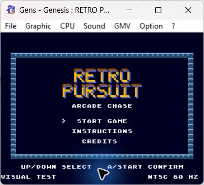
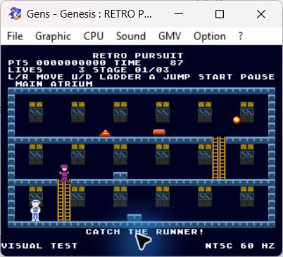
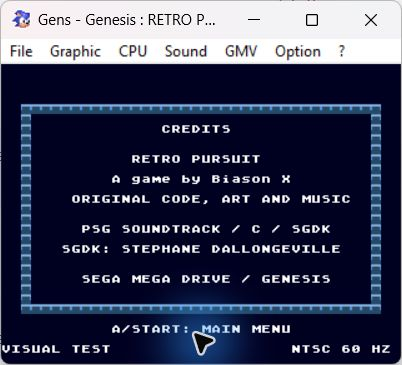
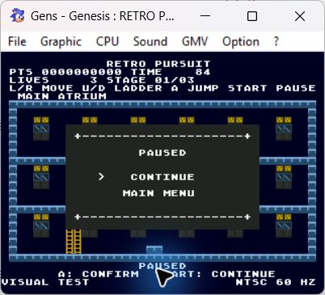

# Retro Pursuit 1.0

Jogo original para Mega Drive / Genesis em C com SGDK 1.90.

A game by Biason X.

**Versão candidata:** [baixar a ROM na release v1.0-rc1](https://github.com/abiason/Retro-Pursuit-MD/releases/tag/v1.0-rc1) ou [ver a cópia versionada](release/Retro-Pursuit-1.0.bin) e [conferir SHA-256](release/SHA256SUMS.txt). Abrir em emulador Mega Drive / Genesis compatível. As pendências de aceite estão documentadas abaixo.

## Screenshots

| Título | Partida |
| --- | --- |
|  |  |
| Créditos | Pausa |
|  |  |

Capturas reais do Gens KMod em NTSC, usando o roteiro de inspeção visual. O rodapé VISUAL TEST identifica a ROM de teste usada nas capturas; a ROM candidata da release usa o controle normal e não exibe essa marca.

Versão 1.0: trilha PSG original, efeitos de eventos, oito poses por personagem, logotipo e cenários refinados. Campanha de três fases com mapas, escadas, degraus e cores próprios; tempo menor, criminoso mais rápido e mais obstáculos ao avançar. Mantém menus, pausa, dano, proteção, pontuação e Game Over, com simulação inteira a 120 Hz e apresentação PAL/NTSC.

| Fase | Cenário | Tempo | Velocidade do criminoso | Obstáculos |
| --- | --- | --- | --- | --- |
| 1 | Main Atrium | 90 s | 90 px/s | 3 |
| 2 | East Gallery | 80 s | 101,25 px/s | 4 |
| 3 | Security Hub | 70 s | 112,5 px/s | 5 |

Capturas avançam para a próxima fase preservando pontos e vidas. Após a terceira, ALL STAGES CLEAR encerra a campanha; A inicia outra e START volta ao menu. Falhar por tempo repete a fase atual.

## Compilar

Requer SGDK 1.90 e Java no PATH. No PowerShell:

```powershell
& C:\sgdk190\bin\make.exe -f Makefile release
```

ROM: `out/rom.bin`. Para outro caminho do SDK, passar `SGDK=C:/caminho/sgdk190` ao Make. Abrir a ROM em emulador compatível.

## Controles

- No menu: cima/baixo seleciona, A ou START confirma.
- Na partida: esquerda/direita move, cima/baixo usa escadas e A pula.
- START pausa e continua; na pausa, cima/baixo e A também permitem escolher Continuar ou Menu principal.
- Em instruções e créditos: A ou START volta ao menu.
- Após resultado: A continua/reinicia e START retorna ao menu.

A pausa congela tempo, posições, IA, obstáculos, animação e proteção. O menu principal inicia uma nova sessão; sair de uma partida pelo menu descarta a sessão anterior ao iniciar outra. Botões mantidos não confirmam ou pausam repetidamente.

Conferir o mapeamento de controle ou teclado no emulador antes de jogar.

## Testes

Com GCC nativo no PATH:

```powershell
.\tools\test.ps1
```

O script compila e executa dez suítes C99 com avisos tratados como erros: personagem, colisões, cenário, IA, pontuação/tempo, sessão, obstáculos/dano, interface, campanha e áudio. Com Python 3, `python tools/verify_rom.py` confere o cabeçalho e checksum próprio do SGDK.

Consultar [regras](docs/gameplay.md), [build](docs/build.md), [arquitetura](docs/architecture.md) e [validação](docs/validation.md). Consultar também a [cobertura de requisitos](docs/requirements.md) e as [notas da entrega](docs/release-1.0.md).


Para inspeção visual automatizada, `tools/build-ui-smoke.ps1` gera `out/00-ui-smoke.bin`, marcada VISUAL TEST. Ela percorre as telas em ciclo e inclui resultados sintéticos de teste; a ROM jogável continua sendo `out/rom.bin`.


`tools/build-ui-smoke.ps1 -Campaign` gera `out/00-campaign-smoke.bin`, marcada CAMPAIGN TEST, para observar os três mapas e o encerramento usando capturas controladas. A ROM jogável continua sendo `out/rom.bin`.

A prévia aproximada da trilha e efeitos pode ser gerada em `out/audio-preview.wav` conforme docs/build.md. A pausa silencia todos os canais e retoma a sequência no mesmo ponto.

## Entrega

O pacote `dist/Retro-Pursuit-1.0.zip` contém a ROM `Retro-Pursuit-1.0.bin`, fontes, testes, documentação, logs de compilação e manifesto SHA-256. Para gerar outra entrega, consultar docs/build.md.

Limites conhecidos: não há elevadores nem itens coletáveis; o progresso não é salvo. Audição no emulador, avaliação de dificuldade por jogadores, apresentação PAL e hardware real ainda precisam de validação manual. A paridade da lógica PAL/NTSC é coberta pelos testes.
