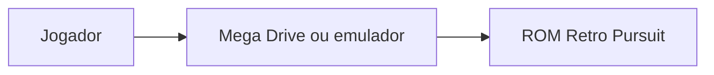
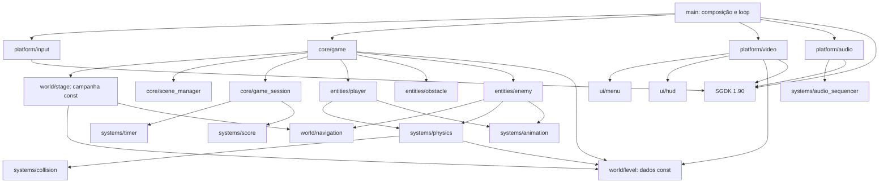
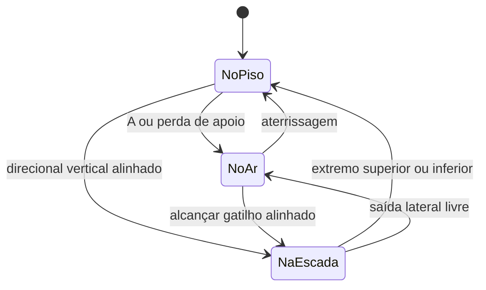
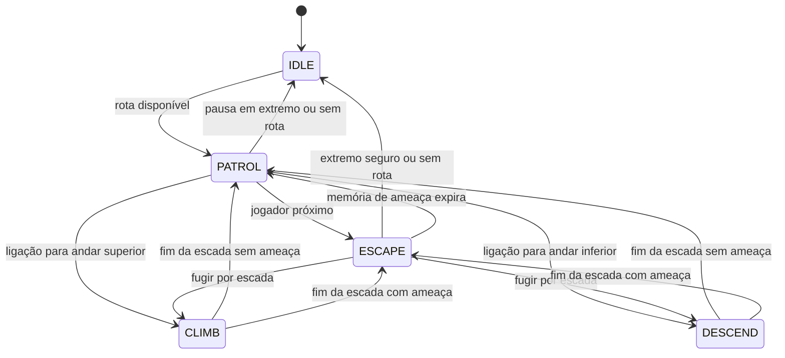
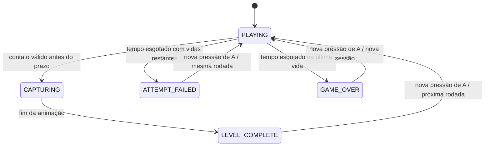
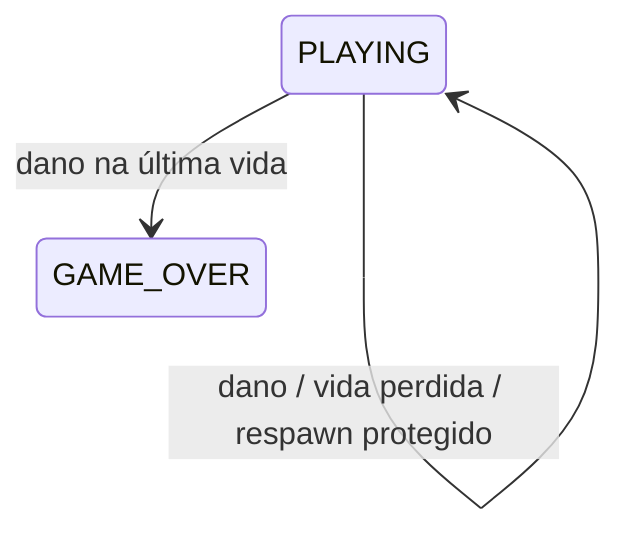
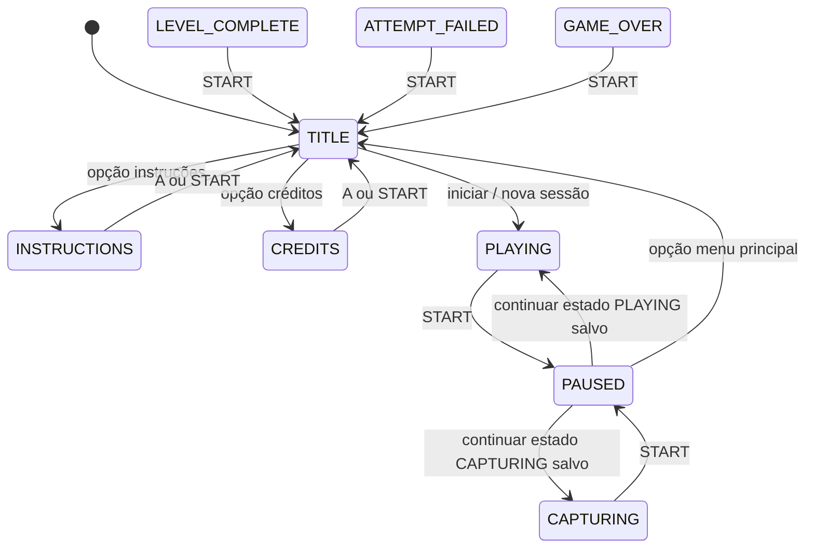
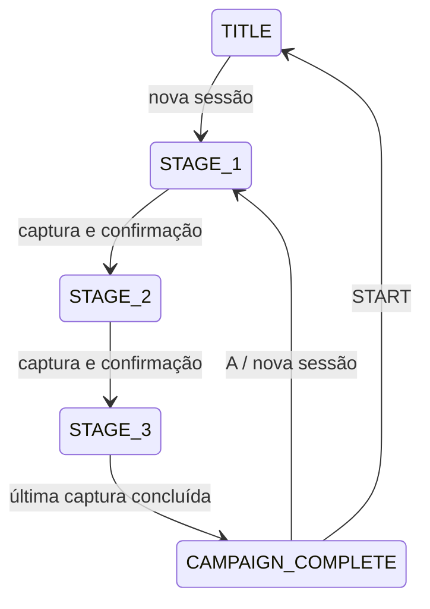

# Arquitetura — Retro Pursuit 1.0

## Componentes

O domínio usa inteiros, dados constantes e armazenamento estático. `core/types.h` adapta os tipos do SGDK e do host. Não há alocação dinâmica no código da aplicação.

`Game` contém sessão, regras, SceneManager, personagem, criminoso, pool de obstáculos, índice e configuração de fase, ponteiro para LevelConfig, acumulador de ticks e botão A anterior. O controle é traduzido em dois eixos e botão de salto. A lógica executa 120 ticks por segundo: dois por quadro NTSC e dois/três por quadro PAL.

`LevelConfig` referencia retângulos sólidos e escadas constantes, contagens e posição inicial. A fase de teste tem três andares e duas escadas. Os mesmos retângulos alimentam renderização e física, evitando um mapa visual divergente do mapa de colisão. A representação visual atual exige coordenadas e dimensões múltiplas de oito; a física opera em subpixels.

`Player` contém posição em unidades de 1/256 pixel, velocidade por tick, orientação, animação, contato com piso e índice de escada (-1 quando inativo). As dimensões de colisão são constantes de domínio independentes dos tiles do sprite.

`Physics` aplica aceleração, frenagem, gravidade e impulso. `Collision` resolve primeiro X e depois Y contra a superfície cruzada mais próxima. Contato tangente não é sobreposição. O contato com o piso é recalculado a cada tick; ao sair de uma plataforma, o personagem perde apoio. Pisos são sólidos também por baixo e nas laterais.

Escadas são gatilhos, não sólidos: cima/baixo inicia a travessia quando o centro do personagem está dentro da largura e os pés no intervalo vertical válido. A posição alinha ao eixo da escada. Durante a travessia, os pisos conectados podem ser atravessados. A saída lateral só ocorre se o corpo estiver fora de sólidos; os extremos devolvem o personagem à superfície. As escadas da fase estão livres de paredes ou degraus no eixo. Não há pulo durante a travessia.

`Animation` seleciona oito poses: repouso, dois passos, salto, duas poses de escada, captura e dano. `Video` usa sprites 16 × 24 com espelhamento e 48 tiles por personagem. O cenário é desenhado quando muda o mapa ou a tela, incluindo entrada/saída da pausa; sprites usam a fila DMA por quadro. HUD e PSG atualizam apenas valores alterados. Há somente uma chamada a SYS_doVBlankProcess por quadro. A seção da Fase 9 detalha áudio e VRAM.

## C4 — contexto e componentes

## Estados de movimento

## Decisões

- Preservar SGDK 1.90 e build oficial makefile.gen no Windows disponível.
- Domínio testável com GCC convencional, inclusive no Linux.
- Manter os desenhos originais em tiles declarados em C; o header do personagem é gerado por tools/generate_player.py e não exige Python no build da ROM.
- Preservar boot e avisos do SGDK; cabeçalho com identidade Retro Pursuit.
- Os degraus continuam geometria sólida sem dano; obstáculos nocivos usam gatilhos separados da colisão de cenário.

## IA e navegação — Fase 4

`Enemy` compõe o motor de movimento existente (`Player body`), uma configuração e seu estado de IA. Reutilizar o motor preserva colisão, gravidade, escadas e animação; o inimigo não lê o controle e tem posição e velocidade próprias. O motor agora aceita limite de velocidade explícito, mantendo o valor anterior do jogador.

`EnemyConfig` define nó inicial, velocidade, raio de percepção e pausa nos extremos. O teste usa velocidade horizontal de 90 pixels por segundo (jogador: 120), raio de percepção de 96 pixels com distância vertical ponderada, pausa de meio segundo e memória de ameaça de dois segundos. Não há aleatoriedade.

`NavigationGraph` tem dez nós e nove ligações bidirecionais: extremidades, entradas de escada e conexões entre andares. Cada ligação identifica caminhada ou escada. BFS limitada a dezesseis nós procura o próximo passo com fila e pais em arrays locais fixos. Índices inválidos e destinos desconectados retornam falha; sem caminho, a IA permanece em IDLE. Os dados do grafo devem corresponder ao mapa: nós apoiados em pisos, escadas conectando os mesmos extremos e caminhos de caminhada transitáveis.

Na patrulha, o criminoso alterna entre as extremidades inferior esquerda e superior direita, usando as duas escadas. Ao perceber o jogador, procura um nó distante. Penaliza um primeiro passo na direção do jogador no mesmo andar e uma troca de andar que o aproxime verticalmente. A ameaça tem memória para evitar oscilação imediata entre patrulha e fuga. Decisões de rota ocorrem nos nós ou no início de uma ameaça; uma espera curta limita buscas ao permanecer num ponto seguro.

O agente alinha ao eixo da escada antes de subir/descer. Um sensor frontal solicita salto sobre degraus baixos quando há apoio; a física continua responsável pela resolução. A geometria atual oferece trajeto de patrulha válido nos dois sentidos. A IA é simples e não garante uma rota ideal contra um jogador que bloqueie todos os acessos.

Base da Fase 4: dois sprites de hardware encadeados, 24 tiles originais para cada personagem e dois para cenário. A Fase 6 acrescenta cinco tiles e os sprites dos obstáculos. Jogador usa paleta 1, cenário paleta 2 e criminoso paleta 3. Todos os tiles são carregados na inicialização; posições e quadros vão pela fila DMA por quadro.

## Sessão — Fase 5

`GameRules` centraliza tempo limite, vidas iniciais, duração da captura e regras de pontos. Valores padrão: 90 segundos, três vidas, 60 ticks de animação (meio segundo), 1000 por captura, 10 por segundo restante e 500 por rodada. `game_init_with_rules` permite testes com outros valores e normaliza limites nulos para um.

`GameSession` contém estado, timer, pontuação de 32 bits, vidas, rodada e contador da animação. `Timer` usa ticks inteiros a 120 Hz e exibe segundos arredondados para cima; zero é terminal. `Score` soma com saturação em 0xFFFFFFFF, evitando wrap. Na Fase 8, o campo interno round passa a refletir o identificador da fase (1 a 3), controlado pela campanha. Todos os dados são estáticos e a lógica não depende do SGDK.

Em PLAYING, cada tick primeiro avança o timer. Se ele zerar, a tentativa termina antes de movimento ou captura, dando prioridade explícita ao prazo. Caso contrário, atualiza os dois atores e verifica sobreposição AABB em subpixels. A captura valida o estado, concede pontos uma única vez, zera velocidades e passa para CAPTURING. Durante essa fase, posições e timer ficam congelados; somente quadros/animação provisória mudam. Ao final, LEVEL_COMPLETE aguarda nova pressão de A.

No tempo esgotado, uma vida é descontada uma única vez: ATTEMPT_FAILED com vidas restantes ou GAME_OVER ao zerar. A confirma a próxima ação somente pela borda de pressão. Repetir rodada preserva pontos e número; concluir incrementa o número e preserva vidas/pontos; Game Over reinicia tudo. Todos esses caminhos reinicializam posições, IA e timer. A confirmação não vaza como salto automático na nova tentativa.

A Fase 8 substitui a repetição de rodadas por campanha finita orientada a dados, descrita abaixo. Os estados auxiliares de resultado atendem à mecânica principal; a Fase 7 acrescenta menus e pausa sem antecipar novo conteúdo.

`ui/hud` apresenta valores e instruções mínimas de resultado. Um cache evita reescrever valores que não mudaram. A renderização pisca o criminoso durante a captura e o oculta após a conclusão. Os tipos e cálculos continuam inteiros e o loop mantém uma chamada a VBlank por quadro.

## Obstáculos e dano — Fase 6

`ObstaclePool` mantém até dezesseis objetos estáticos, sem malloc/free. `ObstacleConfig` referencia tipo, posição, hitbox, limites de percurso e velocidade. A inicialização examina no máximo as primeiras dezesseis configurações e ignora entradas inválidas. Hitboxes devem caber no desenho (16 x 8 para cone/carrinho e 8 x 8 para objeto vertical); dimensões e posições devem permanecer na tela. São centralizadas horizontalmente e alinhadas à base do sprite.

Tipos atuais: STATIC, HORIZONTAL e VERTICAL. A posição usa ponto fixo de 1/256 pixel, a velocidade usa essas unidades por tick de 120 Hz e os limites usam pixels inteiros. A velocidade máxima é um pixel por tick. Nos extremos, a posição é limitada e a direção invertida. Um percurso de amplitude zero permanece parado. Configurações const definem os três objetos atuais, todos no andar superior, sem mudar a geometria aprovada dos pisos.

`obstacles_hit` usa AABB varrida com movimento relativo entre as posições anterior e atual do jogador e do objeto. Compara intervalos temporais por frações inteiras; não usa ponto flutuante. Contatos apenas tangentes, inclusive em cantos, não causam dano. O contrato recebe a posição do jogador no início do mesmo tick; com o motor limitado a quatro pixels por tick e obstáculos a um, os produtos das frações permanecem dentro de 32 bits. O teleporte de respawn acontece depois da detecção, sem produzir um trajeto artificial de colisão.

Ordem do tick: timer/proteção, movimento dos obstáculos, jogador, criminoso, dano e captura. Prazo esgotado prevalece sobre ambos; dano aceito prevalece sobre captura simultânea. `session_damage` só aceita dano em PLAYING, com tempo, vidas e sem proteção; desconta uma vida uma vez. Havendo vidas, atribui 240 ticks de proteção e Game reinicializa apenas o jogador, inclusive estado de escada. O timer, pontos, rodada, inimigo e obstáculos são preservados. Na última vida, muda para GAME_OVER e a simulação para.

A proteção diminui por tick, não por quadro, e o dano volta a ser aceito precisamente ao zerar. Capturas continuam válidas sob proteção. Novas tentativas, rodadas e sessões reinicializam o pool e zeram a proteção. Em captura e estados de resultado, os obstáculos ficam congelados junto aos atores. O HUD atualiza a mensagem quando a proteção começa/termina e a renderização pisca o jogador protegido.

Renderização final: cinquenta e cinco tiles originais (1760 bytes), cinco sprites na configuração atual e até dezoito com o pool completo. Cone/carrinho usam dois tiles cada, e o objeto vertical usa um. Reutilizam cores livres da paleta 2, preservando as paletas dos personagens e a sincronização única de VBlank. Os headers gerados são mantidos no código; Python só é necessário para regenerar o desenho com tools/generate_obstacles.py.

Os obstáculos são gatilhos nocivos apenas para o jogador; o inimigo mantém seu motor e navegação anteriores. Não há nova alocação ou biblioteca de runtime.

## Fluxo de interface — Fase 7

`SceneManager` mantém seleção do menu inicial, seleção da pausa e estado suspenso. Funções puras classificam telas e fazem navegação circular com índices limitados. `ui/menu` desenha título, instruções, créditos e opções de pausa; não modifica o domínio.

`game_init` e `game_init_with_rules` inicializam dados e abrem TITLE. `game_start_session` inicia explicitamente uma sessão jogável. A seleção de início reinicializa atores, obstáculos, timer, vidas, rodada e pontos. `game_show_title` abandona a sessão e restaura a seleção inicial; os dados anteriores não são simulados no menu e serão substituídos ao iniciar outra partida. Instruções e créditos retornam ao título preservando a opção selecionada.

`InputState` acrescenta START. Game calcula bordas de A/START e mudanças do eixo vertical em todos os estados, inclusive pausado. START tem prioridade em partida e resultados. Assim, manter o botão que abriu uma tela não confirma a seguinte, e a confirmação não se transforma em salto ao retornar à simulação.

A pausa aceita PLAYING e CAPTURING e salva o estado exato. Enquanto PAUSED, o acumulador fracionário de ticks não muda; timer, proteção, atores, IA, obstáculos e captura não avançam. Continuar restaura o estado e retorna sem simular o quadro de confirmação. Isso preserva inclusive a alternância de dois/três ticks PAL. A apresentação usa o estado suspenso para congelar também o piscar do jogador e do criminoso.

O loop principal continua processando entrada, apresentação e VBlank em todas as telas. O renderer armazena tipo de tela, estado e seleção: redesenha os planos nas transições, somente o cursor em mudanças de seleção e mantém o cenário durante a pausa. Menus escondem a cadeia de sprites; o retorno à partida restaura o cenário e o HUD, removendo textos anteriores. VDP_clearPlane é usado com espera por conclusão DMA, sem introduzir outra sincronização de VBlank.

Game Over, conclusão de fase/campanha e tempo esgotado mantêm a confirmação rápida por A e acrescentam START para o menu. A pausa oferece CONTINUE ou MAIN MENU; START sempre continua. Abandonar pelo menu não permite retomar a sessão antiga.

Os testes de domínio anteriores usam tests/test_support.h para iniciar explicitamente a sessão sem passar pelo título. A suíte test_ui verifica o boot e o fluxo real dos menus. Um harness separado em tests/rom_ui_smoke.c usa a mesma implementação de jogo/renderização para a inspeção no emulador; seus resultados sintéticos são claramente identificados e não fazem parte do executável de produção.

## Campanha e conteúdo — Fase 8

`world/stage` agrega dados const em StageConfig: identificador, dificuldade, tempo limite, nome, LevelConfig, NavigationGraph, EnemyConfig, configurações/contagem de obstáculos e cores de cenário. Há três entradas, com limite de capacidade MAX_LEVELS=10 verificado na compilação. stage_get valida índices e retorna nulo fora da campanha.

A primeira entrada referencia os dados originais aprovados: level_test, navigation_test, enemy_test_config e obstacles_test_config. As outras duas possuem geometria, posições de escada, grafos e configurações próprios. Os pisos e a física mantêm o mesmo modelo; mudam degraus, percurso, ameaças e ritmo. Nenhum conteúdo é alocado dinamicamente.

`game_begin_stage` é o ponto único de carregamento: valida o índice antes de alterar o jogo, seleciona mapa e regras, define o identificador em session.round, reinicia timer/estados de tentativa e recria atores e pool a partir da fase. Pontos e vidas permanecem intactos. O Game mantém stage e stage_index, e os adaptadores de renderização consomem esses mesmos dados.

A confirmação de LEVEL_COMPLETE chama o carregamento da próxima fase; ATTEMPT_FAILED recarrega a atual. Game Over e encerramento da campanha iniciam uma nova sessão na fase zero. No fim da animação da última captura, o controlador converte LEVEL_COMPLETE em CAMPAIGN_COMPLETE, congelando a simulação e sem acessar uma entrada inexistente.

A API game_init_with_rules com regras explícitas preserva a possibilidade de sobrescrever o tempo para testes ou configuração. O fluxo padrão game_init usa os tempos da campanha. As demais regras de vidas, pontuação e proteção continuam configuráveis e iguais entre fases.

Dificuldade atual: tempos 90/80/70 s; velocidades 192/216/240 unidades de subpixel por tick (90/101,25/112,5 px/s); raios de percepção 96/112/128 px ponderados verticalmente; pausas 60/48/30 ticks; obstáculos 3/4/5, com móveis progressivamente mais rápidos. A velocidade do jogador permanece em 256 unidades por tick (120 px/s).

Video também compara o ponteiro do mapa para invalidar o cache. Assim, avançar de resultado para PLAYING redesenha planos, cores, nome e HUD mesmo sem passar pelo menu. O HUD apresenta STAGE atual/total. A conclusão final usa mensagem própria e permite nova campanha ou menu.

A validação dos dados verifica grafos conectados, ligações de escada correspondentes à geometria, nós apoiados fora de sólidos e ameaças, pools completos, trajetos a velocidades de inimigo/jogador e saltos sobre cada obstáculo. Ajuste fino de desafio com jogadores reais continua sendo uma avaliação de jogabilidade, distinta desses testes determinísticos.

## Fase 9: áudio e recursos visuais

Game acumula flags de eventos durante os subpassos de cada frame. O sequenciador portátil systems/audio_sequencer transforma estado, fase e eventos em três frequências e quatro atenuações PSG. platform/audio aplica somente registros alterados ao PSG do SGDK. A voz 0 toca melodia, a 1 baixo, a 2 efeitos; ruído fornece percussão e dano. Temas de menu e perseguição e jingles são originais, definidos em tabelas C. Não há recursos PCM ou FM.

A sequência usa ticks de 120 Hz, com acumulador para apresentação a 50/60 Hz. Prioridades impedem efeitos pequenos de interromper dano ou resultados. Contato lateral emite apenas na borda; manter direção contra parede não repete o efeito. Pausa preserva fase musical, efeito e resto do acumulador, envia silêncio e retoma exatamente.

assets.h centraliza índices de VRAM: 48 tiles por personagem (oito poses de seis tiles), oito de cenário, cinco de obstáculos e 96 de logotipo: 205 tiles, 6560 bytes. Uma asserção de compilação limita a faixa reservada. Os geradores Python emitem os cabeçalhos C. Loja, vidro, grades e pilares são decorativos, sem novos colisores. A pausa oculta sprites e desenha um painel; ao sair, o cenário é restaurado.
